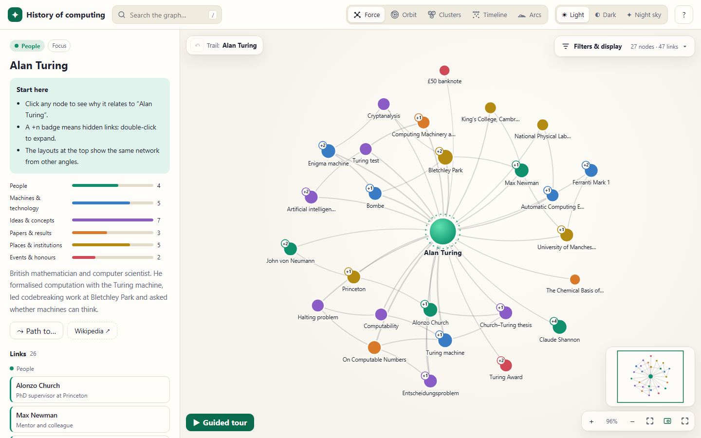
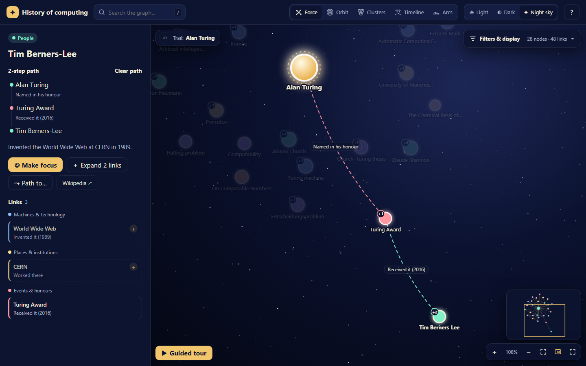
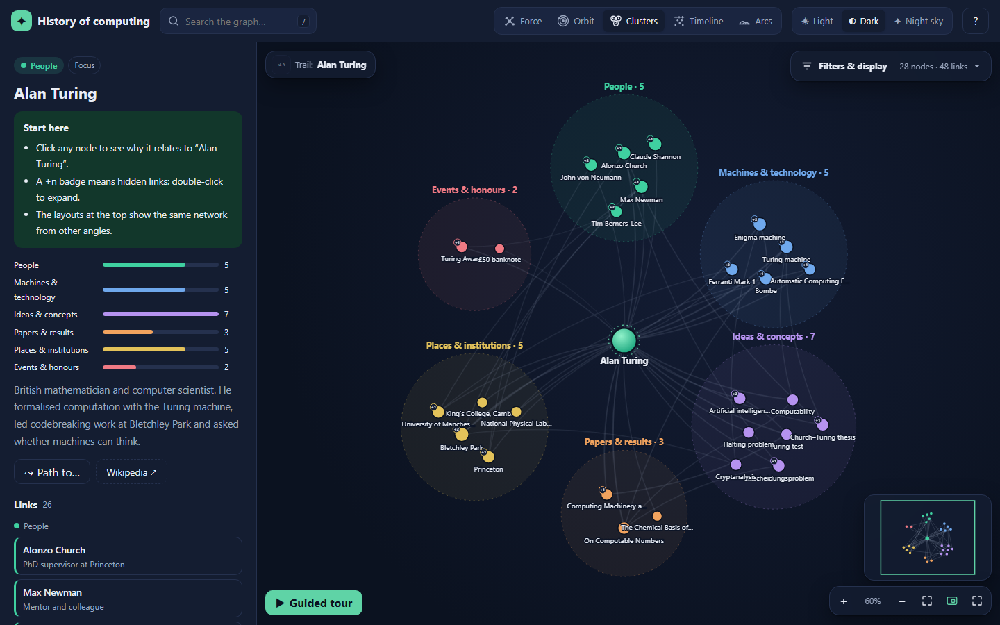
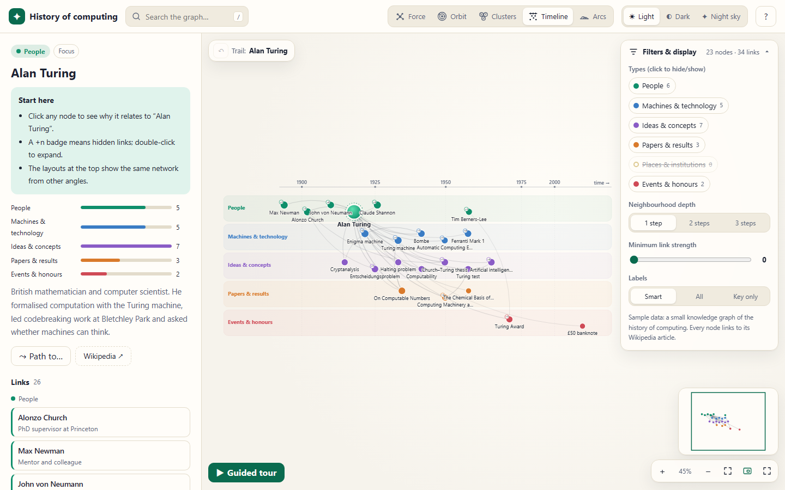
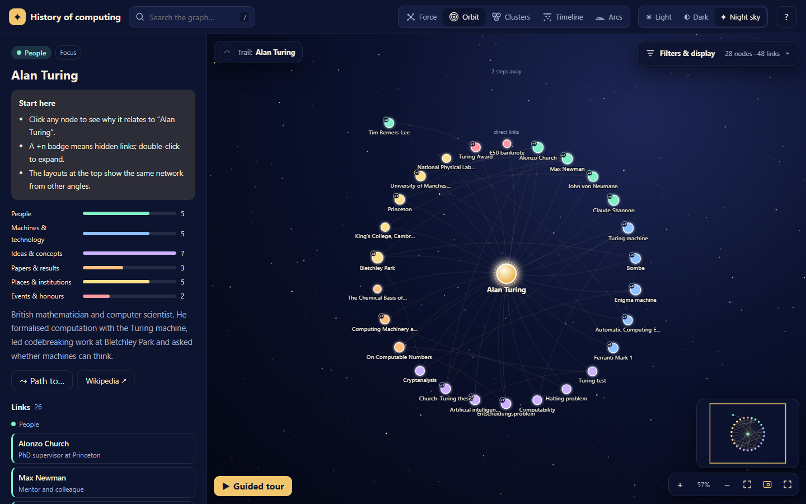
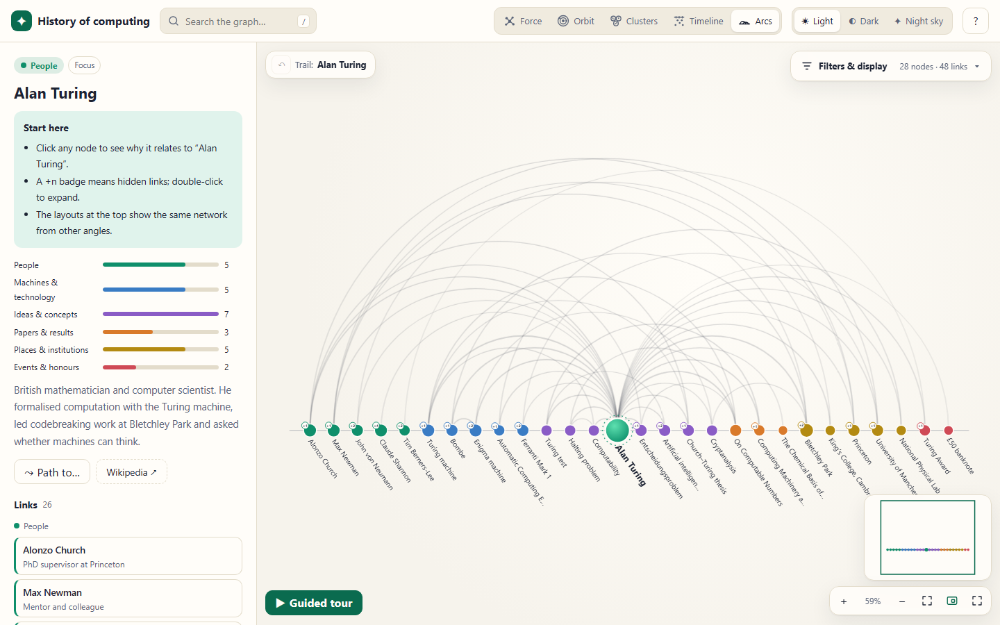
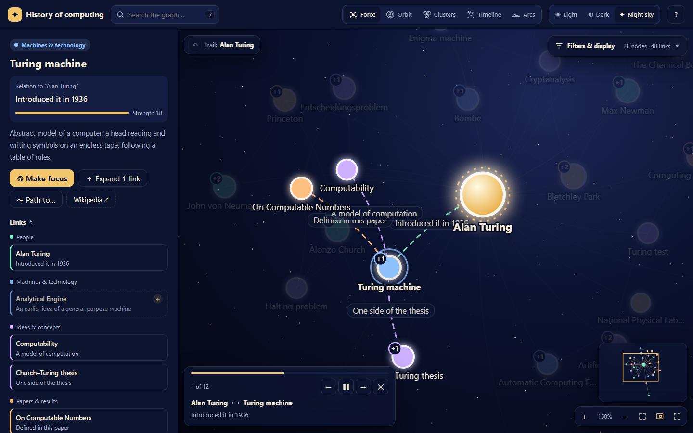
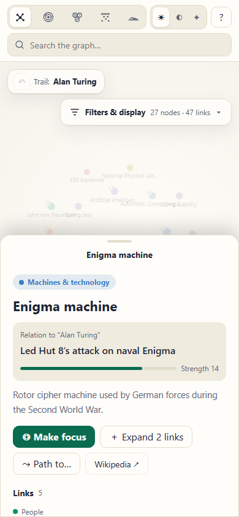
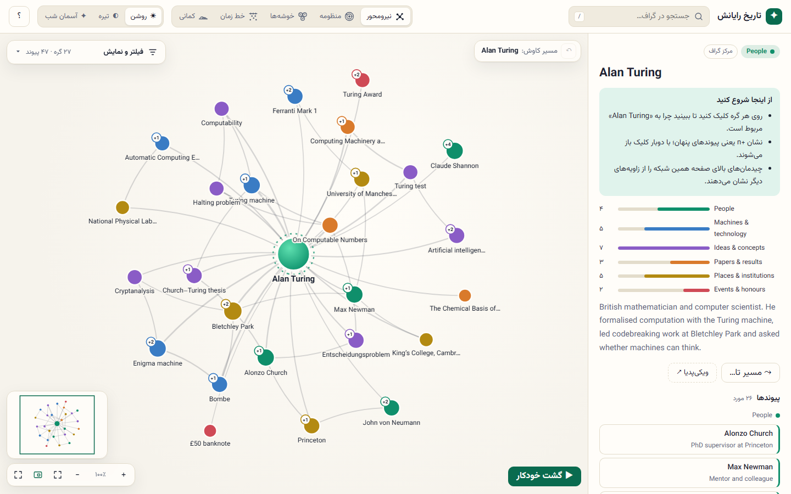

# Angular Knowledge Graph Viewer — Interactive Graph Visualization Component (D3 Alternative)

[](https://github.com/F-mahmoodi/angular-knowledge-graph/actions/workflows/ci.yml)
[](LICENSE)


**angular-knowledge-graph** is an open-source **knowledge graph viewer for Angular**: a single, ready-made component, `<ngx-constellation>`, that **displays a graph of nodes and relationships** and lets users explore it interactively.

Pass it `{ nodes, edges }` and you get:

- a polished, interactive **graph visualization** with **five layouts** (force-directed, orbit, clusters, timeline, arcs),
- search, shortest-path highlighting, step-by-step neighbour expansion and a guided tour,
- light, dark and *night-sky* themes,
- full **RTL / Persian** support.

You don't write any rendering or layout code yourself. That makes it a drop-in **alternative to building a graph view with D3**. It has **zero dependencies** beyond Angular, and is written in TypeScript with signals.

**[▶ Live demo](https://f-mahmoodi.github.io/angular-knowledge-graph/)** · [Installation](#installation) · [Quick start](#quick-start-display-a-knowledge-graph-in-angular) · [API](#api-reference) · [FAQ](#faq)



---

## Contents

- [What it is, and what it isn't](#what-it-is-and-what-it-isnt)
- [Features](#features)
- [Screenshots](#screenshots)
- [Installation](#installation)
- [Quick start](#quick-start-display-a-knowledge-graph-in-angular)
- [Graph data model](#graph-data-model-nodes-and-edges)
- [API reference](#api-reference)
- [Theming](#theming)
- [Internationalization and RTL](#internationalization-and-rtl)
- [Keyboard shortcuts and gestures](#keyboard-shortcuts-and-gestures)
- [Use cases](#use-cases)
- [FAQ](#faq)
- [Development](#development)
- [راهنمای فارسی](#راهنمای-فارسی)

## What it is, and what it isn't

**It is a viewer component.** It renders a graph you give it, and lets people explore that view interactively:

- select nodes, read why they are related, and expand hidden neighbours;
- re-center on a node, find paths, search and filter;
- switch between layouts.

**It is not** a graph database, a query engine, or a graph editor. Your app loads the data (from an API, a JSON file, a triple store…) and passes `{ nodes, edges }` to the component. Users never change your data. They only change *what they see*.

**Compared with D3.** With D3 you assemble a graph view yourself:

- force simulation,
- SVG rendering,
- zoom and pan,
- labels, tooltips, filters and a details panel,
- responsive behaviour and accessibility.

**angular-knowledge-graph** packages all of that as one Angular component with inputs, outputs and two-way bindings, styled and ready to use. If you need a bespoke chart unlike anything here, D3 is still the right tool. If you need a good-looking, explorable knowledge-graph view in an Angular app, this saves you the work.

## Features

**Five graph layouts, animated between each other**

- **Force-directed graph:** organic, physics-based layout. Drag a node to pin it.
- **Orbit (radial):** the focus node is the sun. Direct links orbit on the first ring and farther nodes on outer rings.
- **Clusters:** nodes are grouped into coloured bubbles by type or category.
- **Timeline:** nodes on a time axis, with one swim-lane per type and labelled eras.
- **Arc diagram:** all nodes on one line, and arcs show the connections.

**Interactive exploration of the view**

- Details panel that shows the relation label, the relation strength, and all links grouped by type.
- `+n` badges for hidden neighbours. Double-click to show them, double-click again to hide.
- Re-center on any node, with a breadcrumb trail and a back button.
- Shortest-path highlighting (Shift+click or "Path to…").
- Search with suggestions. Hidden results are revealed together with their path.
- Guided tour that auto-plays through the strongest relationships, with captions.
- Filters by type, neighbourhood depth (1–3 steps) and minimum link strength, plus smart label modes.
- Minimap, zoom, pan, pinch, fit-to-view and fullscreen.

**Design and quality**

- **Themes:** light, dark and **night sky** (twinkling stars, glowing nodes and constellation-like edges). `auto` follows the OS setting. Everything is themeable with CSS custom properties.
- **Accessibility:** keyboard navigation (works with a Persian keyboard layout too), focusable nodes with ARIA labels, live regions, and `prefers-reduced-motion` support.
- **Responsive:** on narrow containers the panel becomes a mobile bottom sheet, and touch gestures are supported.
- **Languages:** English (LTR, default) and Persian (RTL) built in, and every string is overridable. Mixed-direction titles render correctly.
- **Modern Angular:** a standalone, signal-based, `OnPush` component that works zoneless and is SSR-safe. It has two-way bindings with `model()`.
- **Lightweight:** no runtime dependencies. The rendering engine is plain TypeScript + SVG.

## Screenshots

| Shortest path between two entries (night sky) | Cluster layout (dark theme) | Timeline layout with filters |
| --- | --- | --- |
|  |  |  |
| **Orbit layout (night sky)** | **Arc diagram** | **Guided tour** |
|  |  |  |
| **Mobile bottom sheet** | **Right-to-left interface (Persian)** | |
|  |  | |

*Sample data in the screenshots: a small knowledge graph of the history of computing, centred on Alan Turing.*

## Installation

```bash
npm install angular-knowledge-graph
```

Requires Angular **22.2+** (`@angular/core`, `@angular/common`).

> Until the first npm release, install it from source:
> `npm ci && npm run pack:lib`, then `npm install path/to/angular-knowledge-graph-0.1.0.tgz` in your app.

## Quick start: display a knowledge graph in Angular

```ts
import { Component, signal } from '@angular/core';
import {
  ConstellationData,
  ConstellationNode,
  ConstellationType,
  NgxConstellation,
} from 'angular-knowledge-graph';

@Component({
  selector: 'app-root',
  imports: [NgxConstellation],
  template: `
    <ngx-constellation
      style="height: 100vh"
      [data]="graph"
      [types]="types"
      [(focus)]="focus"
      (nodeSelect)="onSelect($event)"
    />
  `,
})
export class App {
  focus = signal<string | null>('sun');

  types: ConstellationType[] = [
    { key: 'star', label: 'Stars', color: '#d97a2b' },
    { key: 'planet', label: 'Planets', color: '#3a7cc4' },
  ];

  graph: ConstellationData = {
    nodes: [
      { id: 'sun', title: 'Sun', type: 'star', snippet: 'The star at the center of the Solar System.' },
      { id: 'earth', title: 'Earth', type: 'planet' },
      { id: 'mars', title: 'Mars', type: 'planet' },
    ],
    edges: [
      { source: 'sun', target: 'earth', weight: 5, label: 'orbits' },
      { source: 'sun', target: 'mars', weight: 3, label: 'orbits' },
      { source: 'earth', target: 'mars', weight: 1, label: 'neighbours' },
    ],
  };

  onSelect(node: ConstellationNode | null) {
    console.log('selected', node);
  }
}
```

> **Give the element a height.** The graph viewer fills its container (`height: 100%`, min 420px).

## Graph data model: nodes and edges

```ts
interface ConstellationNode {
  id: string;
  title: string;
  type: string;           // category; matches ConstellationType.key (unknown types get automatic colors)
  era?: number | null;    // position on the timeline (any numeric scale: years, centuries, era index…)
  snippet?: string;       // short description in the details panel
  image?: string;         // absolute image URL shown in the panel
  url?: string;           // target of the "open entry" button
  tags?: string[];        // small tags next to the type pill
  data?: unknown;         // your own payload (handy in detailTemplate)
}

interface ConstellationEdge {
  source: string;
  target: string;
  weight?: number;        // relation strength (default 1): thickness, distance, filtering
  label?: string;         // why the two nodes are related; shown on the edge and in the panel
  data?: unknown;
}

interface ConstellationType { key: string; label: string; color?: string; darkColor?: string; skyColor?: string }
interface ConstellationEra  { value: number; label: string }
```

Edges are undirected. Duplicate edges, self-loops and edges that point to unknown nodes are ignored, so you can pass raw API data directly.

## API reference

### Inputs

| Input | Type | Default | Description |
| --- | --- | --- | --- |
| `data` | `ConstellationData` | **required** | Nodes and edges to display. |
| `types` | `ConstellationType[]` | `[]` | Labels and colors per type. The order is used by clusters, lanes and the legend. |
| `eras` | `ConstellationEra[]` | `[]` | Labelled ticks on the timeline axis. |
| `locale` | `'en' \| 'fa'` | `'en'` | Built-in UI language: English (LTR) or Persian (RTL). |
| `strings` | `Partial<ConstellationStrings>` | `null` | Override any UI text (see `STRINGS_EN` / `STRINGS_FA`). |
| `dir` | `'rtl' \| 'ltr' \| null` | locale's | Text direction. |
| `brand` | `string` | `''` | Title at the start of the toolbar. |
| `note` | `string` | `''` | Footnote in the filters card. |
| `features` | `Partial<ConstellationFeatures>` | all on | Toggle parts of the UI ([feature flags](#feature-flags)). |
| `tourDuration` | `number` | `4800` | Milliseconds per step of the guided tour. |
| `maxLabelLength` | `number` | `22` | Longer node labels are truncated. |
| `persistKey` | `string \| null` | `null` | Remember theme and layout in `localStorage`. |
| `showHint` | `boolean` | `true` | Show a gesture hint once on start. |
| `detailTemplate` | `TemplateRef<ConstellationDetailContext>` | `null` | Custom content in the details panel. |

### Two-way bindings (`model()`)

| Model | Type | Default | Description |
| --- | --- | --- | --- |
| `focus` | `string \| null` | most connected node | Node at the center of the view. |
| `selected` | `string \| null` | `null` | Selected node. Setting a hidden node reveals it with its path. |
| `layout` | `'force' \| 'orbit' \| 'cluster' \| 'timeline' \| 'arc'` | `'force'` | Current layout. |
| `theme` | `'auto' \| 'light' \| 'dark' \| 'sky'` | `'auto'` | Current theme. |
| `depth` | `number` (1–3) | `1` | Neighbourhood depth around the focus. |
| `labels` | `'smart' \| 'all' \| 'none'` | `'smart'` | Label visibility. *smart* hides minor labels when zoomed out. |

```html
<ngx-constellation [data]="graph" [(focus)]="focus" [(layout)]="layout" [(theme)]="theme" />
```

### Outputs

| Output | Payload | When |
| --- | --- | --- |
| `nodeSelect` | `ConstellationNode \| null` | The selection changes. |
| `nodeOpen` | `ConstellationNode` | The "open entry" button is used. |
| `nodeExpand` | `{ node, added }` | Hidden neighbours were shown. |
| `pathChange` | `ConstellationNode[] \| null` | A path is highlighted or cleared. |

The models also emit `focusChange`, `selectedChange`, `layoutChange`, `themeChange`, `depthChange` and `labelsChange`.

### Methods

Get the component with `viewChild(NgxConstellation)`:

`fit()`, `zoomIn()`, `zoomOut()`, `recenter(id)`, `reveal(id)`, `showPath(from, to)`, `startTour()`, `stopTour()`.

### Feature flags

```html
<ngx-constellation
  [data]="graph"
  [features]="{ minimap: false, tour: false, globalShortcuts: true, layouts: ['force', 'orbit'] }"
/>
```

| Flag | Default | |
| --- | --- | --- |
| `toolbar`, `search`, `layoutSwitcher`, `themeSwitcher`, `help` | `true` | Top toolbar and its parts. |
| `panel` | `true` | Details panel (a bottom sheet on narrow containers). |
| `filters`, `trail`, `tour`, `minimap`, `zoomControls` | `true` | Overlays on the graph. |
| `openButton` | `true` | The "open entry" button in the panel. |
| `globalShortcuts` | `false` | Listen to shortcuts on the whole page, not only when focus is inside. |
| `layouts` | all five | Which layouts are offered, in order. |

Turn off `toolbar`, `panel`, `filters`, `trail`, `tour` and `minimap` to get a minimal, embedded graph view.

### Custom panel content

```html
<ngx-constellation [data]="graph" [detailTemplate]="extra" />

<ng-template #extra let-node let-isFocus="isFocus">
  <a [href]="'/entries/' + node.id">Read the full entry</a>
</ng-template>
```

## Theming

The host gets `data-theme="light|dark|sky"`, and every color is a CSS custom property:

```css
ngx-constellation[data-theme='light'] {
  --nc-accent: #6d28d9;
  --nc-accent-soft: #ede9fe;
  --nc-bg: #fafafa;
}
ngx-constellation {
  --nc-font: 'Inter', system-ui, sans-serif;
  --nc-radius: 10px;
}
```

Tokens: `--nc-bg`, `--nc-surface`, `--nc-surface-2`, `--nc-ink`, `--nc-muted`, `--nc-line`, `--nc-accent`, `--nc-accent-ink`, `--nc-accent-soft`, `--nc-stage-bg`, `--nc-edge`, `--nc-halo`, `--nc-node-stroke`, `--nc-label`, `--nc-focus-a`, `--nc-focus-b`, `--nc-focus-ring`, `--nc-orbit`, `--nc-shadow`, `--nc-font`, `--nc-radius`.

Node colors come from the `types` input (`color`, `darkColor`, `skyColor`). Styles are global but scoped under `.ngx-constellation` and prefixed with `nc-`, because the SVG nodes are created at runtime.

## Internationalization and RTL

```ts
import { STRINGS_EN } from 'angular-knowledge-graph';

strings = { ...STRINGS_EN, tourStart: 'Take the tour', searchPlaceholder: 'Find an entry…' };
```

```html
<ngx-constellation [data]="graph" [strings]="strings" />
<ngx-constellation [data]="graph" locale="fa" />  <!-- Persian, right-to-left -->
```

- **English (`en`, default):** left-to-right.
- **Persian (`fa`):** right-to-left, with Persian digits and a Persian keyboard layout for shortcuts.
- **Mixed data:** each node title picks its own text direction, so Persian or Arabic titles display correctly inside an English UI, and the other way round.

## Keyboard shortcuts and gestures

| Input | Action |
| --- | --- |
| Click a node | Select it and show its details and links |
| Double-click / <kbd>Space</kbd> | Show or hide hidden neighbours |
| <kbd>Enter</kbd> on the selected node | Make it the focus |
| <kbd>Shift</kbd> + click | Shortest path from the selected node |
| Drag a node | Move it (pinned in the force layout) |
| Drag background / wheel / pinch | Pan and zoom |
| <kbd>←</kbd> <kbd>→</kbd> | Next / previous link of the focus |
| <kbd>1</kbd>–<kbd>5</kbd> | Switch layout |
| <kbd>/</kbd> · <kbd>F</kbd> · <kbd>T</kbd> · <kbd>M</kbd> · <kbd>?</kbd> | Search · fit · tour · minimap · help |
| <kbd>Backspace</kbd> · <kbd>Esc</kbd> | Back in the trail · clear selection / path / tour |

## Use cases

Anywhere an Angular app needs to **show** connected data:

- **Encyclopedias, wikis and knowledge bases:** a "related entries" graph on every article page.
- **Ontology, taxonomy and thesaurus browsers:** view concepts and their relations.
- **Digital humanities:** people, places, texts and events on a timeline.
- **Citation and reference graphs:** papers, authors and sources.
- **Dependency and service maps:** see what depends on what.
- **Learning platforms:** topic maps and prerequisite graphs.

## FAQ

**How do I visualize a knowledge graph in Angular?**
Install `angular-knowledge-graph`, import `NgxConstellation`, and pass `{ nodes, edges }` to `<ngx-constellation [data]>`. See the [quick start](#quick-start-display-a-knowledge-graph-in-angular).

**Is this an alternative to D3 for graphs?**
Yes, for network and knowledge-graph views. Instead of writing a force simulation, SVG rendering, zoom and interaction code with D3, you use one Angular component with a typed API. It doesn't depend on D3, Cytoscape or any other library.

**Is it a graph viewer or a graph editor?**
A **viewer**. Users can explore and rearrange the *view* (select, expand, filter, search, change layout), but the component never modifies your data. Your app stays the source of truth.

**Where does the data come from?**
From your app. Fetch it from any API or file and map it to `{ nodes, edges }`. The component doesn't load or store data itself.

**How large can the graph be?**
It is designed for *focused viewing*: it shows the neighbourhood of a focus node and reveals more on demand. It stays smooth with dozens to a few hundred visible nodes at a time. The full dataset can be larger, because only the visible part is laid out and rendered.

**Does it work with SSR, zoneless apps and standalone components?**
Yes. It renders only in the browser (`afterNextRender`), works without zone.js, and is a standalone component.

**Can I use it with right-to-left languages?**
Yes. RTL is a first-class mode: use `locale="fa"` for the built-in Persian interface, or `dir="rtl"` with your own `strings` for another language.

## Development

```bash
npm ci
npm start             # demo app on http://localhost:4200 (uses the library sources directly)
npm test              # unit tests (Vitest)
npm run build         # library (dist/angular-knowledge-graph) + demo (dist/demo)
npm run pack:lib      # build and pack the library as a .tgz
```

Open the demo with `?lang=fa` for the Persian/RTL interface.

```
projects/
├─ angular-knowledge-graph/      the library
│  └─ src/lib/
│     ├─ ngx-constellation.ts     Angular component (signals, inputs/outputs, UI)
│     ├─ ngx-constellation.html / .css
│     ├─ engine.ts                framework-agnostic scene: SVG rendering, layouts, physics, camera, gestures
│     ├─ graph.ts                 graph index, BFS shortest path, visibility rules (pure, unit-tested)
│     ├─ models.ts                public types
│     └─ strings.ts               Persian & English UI texts
└─ demo/                         demo app (sample data: history of computing)
```

**Publishing to npm:** `npm run build:lib && cd dist/angular-knowledge-graph && npm publish`

**Live demo on GitHub Pages:** enable *Settings → Pages → Source: GitHub Actions* once, then run the **Deploy demo** workflow.

Contributions are welcome. See [CONTRIBUTING.md](CONTRIBUTING.md) and [CHANGELOG.md](CHANGELOG.md).

## Demo data

The demo uses a small, hand-written knowledge graph of **the history of computing** (people, machines, ideas, papers, places and events around Alan Turing). Summaries are written for the demo, and each node links to its Wikipedia article.

## License

[MIT](LICENSE) © Farnaz

---

## راهنمای فارسی

**angular-knowledge-graph** یک **نمایشگر گراف دانش برای Angular** است: یک کامپوننت آماده که داده‌ی گراف (گره‌ها و یال‌ها) را از برنامه‌ی شما می‌گیرد و آن را به‌صورت تعاملی نمایش می‌دهد. جایگزینی آماده برای ساختن نمای گراف با D3 است.

این کامپوننت فقط نمایش می‌دهد. پایگاه داده یا ویرایشگر نیست و داده‌ی شما را تغییر نمی‌دهد.

- **پنج چیدمان:** نیرومحور، منظومه، خوشه‌ها، خط زمان و کمانی. جابه‌جایی بین آن‌ها با انیمیشن انجام می‌شود.
- **سه پوسته:** روشن، تیره و آسمان شب. حالت `auto` از تنظیم سیستم پیروی می‌کند.
- **کاوش در نما:**
  - پنل جزئیات که دلیل و قوت ارتباط هر گره را نشان می‌دهد.
  - نمایش همسایه‌های پنهان با دوبار کلیک.
  - مرکز کردن هر گره، همراه با مسیر کاوش برای بازگشت.
  - برجسته کردن کوتاه‌ترین مسیر بین دو گره.
  - جستجو، گشت خودکار، و فیلتر بر اساس نوع، عمق و قوت ارتباط.
  - نقشه‌ی کوچک و میان‌برهای صفحه‌کلید (با چیدمان فارسی صفحه‌کلید هم کار می‌کنند).
- **موبایل:** پنل جزئیات به برگه‌ی کشویی پایین صفحه تبدیل می‌شود.

**نصب و استفاده:**

```bash
npm install angular-knowledge-graph
```

```html
<ngx-constellation style="height: 100vh" locale="fa" [data]="data" [types]="types" [(focus)]="focus" />
```

زبان پیش‌فرض انگلیسی است. با `locale="fa"` رابط کاربری فارسی و راست‌به‌چپ می‌شود. همه‌ی متن‌ها با ورودی `strings` قابل تغییرند.

برای اجرای نمونه: `npm ci` و سپس `npm start` (برای رابط فارسی، `?lang=fa` را به آدرس اضافه کنید).
