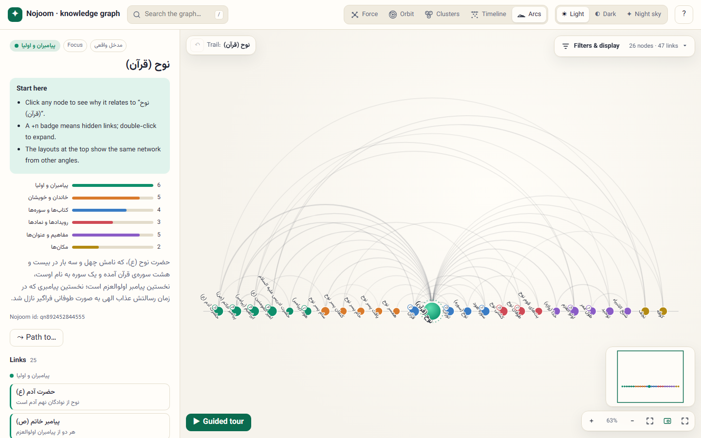

# ngx-constellation ✦

**An interactive, explorable knowledge-graph viewer for Angular.**
Five layouts, three themes (including a starry *night sky*), a details panel, search, shortest-path finding, a guided tour, filters, minimap, keyboard navigation, touch gestures, and full right-to-left (Persian) support.


| Night sky · path between two entries | Clusters · dark | Timeline · filters |
| --- | --- | --- |
|  |  |  |
| **Orbit · night sky** | **Arcs · English (LTR)** | **Mobile** |
|  |  |  |

It was first built for the entity pages of the **Nojoom** Islamic encyclopedia, and works with any graph of entries and relations.

---

## Features

- **Five layouts, animated between each other.** Every layout shows the same network, and nodes glide to their new places.
  - **Force:** an organic, physics-based layout. Drag a node to pin it.
  - **Orbit:** the focus is the sun. Direct links sit on the first ring and farther nodes on outer rings, slowly orbiting.
  - **Clusters:** nodes are grouped into coloured bubbles by type.
  - **Timeline:** nodes are placed on a time axis, with one swim-lane per type and labelled eras.
  - **Arcs:** all nodes sit on one line, and arcs show who connects to whom.
- **Three themes:** light, dark, and *night sky* (twinkling stars with glowing nodes and constellation-like edges). `auto` follows the OS.
- **Exploration tools:**
  - **Details panel:** shows why a node relates to the focus, the relation strength, and all links grouped by type.
  - **+n badges:** a badge means hidden neighbours. Double-click a node to expand them, and double-click again to collapse.
  - **Re-centering:** make any node the focus. A breadcrumb trail lets you go back.
  - **Shortest path:** Shift+click, or use "Path to…". Hidden intermediate nodes are revealed.
  - **Search:** finding a hidden node reveals it together with its path from the focus.
  - **Guided tour:** auto-plays through the strongest links with captions.
  - **Filters:** by type, neighbourhood depth (1–3 steps), and minimum link strength. There are also smart label modes.
- **Navigation:** pan, zoom, pinch, fit-to-view, minimap and fullscreen.
- **Keyboard:** see the [shortcuts](#keyboard--gestures) section.
- **Accessibility:** focusable nodes with ARIA labels and live regions, and `prefers-reduced-motion` is respected.
- **Responsive:** below 900px of *container* width, the panel becomes a bottom sheet.
- **i18n:** Persian (RTL) and English (LTR) built in, and every string is overridable. Mixed-direction titles render correctly.
- **Small footprint:**
  - Zero runtime dependencies besides Angular.
  - A standalone, signal-based, `OnPush`, zoneless-friendly component.
  - SSR-safe: it renders only in the browser.

## Installation

```bash
npm install ngx-constellation
```

Peer dependencies: `@angular/core` and `@angular/common` **≥ 22.2**.

> Until the package is published to npm, build it from this repository:
> `npm ci && npm run build:lib && npm pack ./dist/ngx-constellation`, then `npm install path/to/ngx-constellation-0.1.0.tgz` in your app.

## Quick start

```ts
import { Component, signal } from '@angular/core';
import { ConstellationData, ConstellationNode, ConstellationType, NgxConstellation } from 'ngx-constellation';

@Component({
  selector: 'app-root',
  imports: [NgxConstellation],
  template: `
    <ngx-constellation
      style="height: 100vh"
      locale="en"
      [data]="data"
      [types]="types"
      [(focus)]="focus"
      (nodeSelect)="onSelect($event)"
    />
  `,
})
export class App {
  focus = signal<string | null>('sun');
  types: ConstellationType[] = [
    { key: 'star', label: 'Stars', color: '#d97a2b' },
    { key: 'planet', label: 'Planets', color: '#3a7cc4' },
  ];
  data: ConstellationData = {
    nodes: [
      { id: 'sun', title: 'Sun', type: 'star', snippet: 'The star at the center of the Solar System.' },
      { id: 'earth', title: 'Earth', type: 'planet' },
      { id: 'mars', title: 'Mars', type: 'planet' },
    ],
    edges: [
      { source: 'sun', target: 'earth', weight: 5, label: 'orbits' },
      { source: 'sun', target: 'mars', weight: 3, label: 'orbits' },
      { source: 'earth', target: 'mars', weight: 1, label: 'neighbours' },
    ],
  };
  onSelect(node: ConstellationNode | null) {
    console.log(node);
  }
}
```

> **Give the element a height.** It fills its container (`height: 100%`, min 420px).

## Data model

```ts
interface ConstellationNode {
  id: string;
  title: string;
  type: string;           // matches ConstellationType.key (unknown types get automatic colors)
  era?: number | null;    // position on the timeline (any numeric scale)
  snippet?: string;       // description in the panel
  image?: string;         // absolute image URL shown in the panel
  url?: string;           // target of the "open entry" button
  tags?: string[];        // small tags next to the type pill
  data?: unknown;         // your own payload (handy in detailTemplate)
}

interface ConstellationEdge {
  source: string;
  target: string;
  weight?: number;        // relation strength (default 1): thickness, distance, filtering
  label?: string;         // why they are related; shown on the edge and in the panel
  data?: unknown;
}

interface ConstellationType { key: string; label: string; color?: string; darkColor?: string; skyColor?: string }
interface ConstellationEra  { value: number; label: string }
```

Edges are undirected. Duplicate edges, self-loops and edges that point to unknown nodes are ignored.

## API

### Inputs

| Input | Type | Default | Description |
| --- | --- | --- | --- |
| `data` | `ConstellationData` | **required** | Nodes and edges. |
| `types` | `ConstellationType[]` | `[]` | Labels and colors per type. The order is used by clusters, lanes and the legend. |
| `eras` | `ConstellationEra[]` | `[]` | Labelled ticks on the timeline axis. |
| `locale` | `'fa' \| 'en'` | `'fa'` | Built-in UI language. |
| `strings` | `Partial<ConstellationStrings>` | `null` | Override any UI text. See `STRINGS_EN` / `STRINGS_FA`. |
| `dir` | `'rtl' \| 'ltr' \| null` | locale's | Text direction. |
| `brand` | `string` | `''` | Title at the start of the toolbar. |
| `note` | `string` | `''` | Footnote at the bottom of the filters card. |
| `features` | `Partial<ConstellationFeatures>` | all on | Toggle parts of the UI ([see below](#features-flags)). |
| `tourDuration` | `number` | `4800` | Milliseconds per step of the guided tour. |
| `maxLabelLength` | `number` | `22` | Longer node labels are truncated. |
| `persistKey` | `string \| null` | `null` | Remember theme and layout in `localStorage` under this key. |
| `showHint` | `boolean` | `true` | Show a gesture hint once on start. |
| `detailTemplate` | `TemplateRef<ConstellationDetailContext>` | `null` | Extra content in the details panel. |

### Two-way bindings (`model()`)

| Model | Type | Default | Description |
| --- | --- | --- | --- |
| `focus` | `string \| null` | most connected node | Node at the center. |
| `selected` | `string \| null` | `null` | Selected node. Setting a hidden node reveals it with its path. |
| `layout` | `'force' \| 'orbit' \| 'cluster' \| 'timeline' \| 'arc'` | `'force'` | Current layout. |
| `theme` | `'auto' \| 'light' \| 'dark' \| 'sky'` | `'auto'` | Current theme. |
| `depth` | `number` (1–3) | `1` | Neighbourhood depth around the focus. |
| `labels` | `'smart' \| 'all' \| 'none'` | `'smart'` | Label visibility. *smart* hides minor labels when zoomed out. |

```html
<ngx-constellation [data]="data" [(focus)]="focus" [(layout)]="layout" [(theme)]="theme" />
```

### Outputs

| Output | Payload | When |
| --- | --- | --- |
| `nodeSelect` | `ConstellationNode \| null` | The selection changes. |
| `nodeOpen` | `ConstellationNode` | The "open entry" button is used. |
| `nodeExpand` | `{ node, added }` | Hidden neighbours were expanded. |
| `pathChange` | `ConstellationNode[] \| null` | A path is highlighted or cleared. |

The models also emit `focusChange`, `selectedChange`, `layoutChange`, `themeChange`, `depthChange` and `labelsChange`.

### Methods

Get the component with `viewChild(NgxConstellation)`:

`fit()`, `zoomIn()`, `zoomOut()`, `recenter(id)`, `reveal(id)`, `showPath(from, to)`, `startTour()`, `stopTour()`.

### Features flags

```html
<ngx-constellation
  [data]="data"
  [features]="{ minimap: false, tour: false, globalShortcuts: true, layouts: ['force', 'orbit'] }"
/>
```

| Flag | Default | |
| --- | --- | --- |
| `toolbar`, `search`, `layoutSwitcher`, `themeSwitcher`, `help` | `true` | Top toolbar and its parts. |
| `panel` | `true` | Details panel (a bottom sheet on narrow containers). |
| `filters`, `trail`, `tour`, `minimap`, `zoomControls` | `true` | Overlays on the graph. |
| `openButton` | `true` | The "open entry" button in the panel. |
| `globalShortcuts` | `false` | Listen to shortcuts on the whole document, not only when focus is inside the component. |
| `layouts` | all five | Which layouts are offered, in order. |

### Custom panel content

```html
<ngx-constellation [data]="data" [detailTemplate]="extra" />

<ng-template #extra let-node let-isFocus="isFocus">
  <a [href]="'/entries/' + node.id">Read the full entry</a>
</ng-template>
```

## Theming

The component sets `data-theme="light|dark|sky"` on its host. Every color is a CSS custom property, so you can override any of them:

```css
ngx-constellation[data-theme='light'] {
  --nc-accent: #6d28d9;
  --nc-accent-soft: #ede9fe;
  --nc-bg: #fafafa;
}
ngx-constellation {
  --nc-font: 'Inter', system-ui, sans-serif;
  --nc-radius: 10px;
}
```

Available tokens: `--nc-bg`, `--nc-surface`, `--nc-surface-2`, `--nc-ink`, `--nc-muted`, `--nc-line`, `--nc-accent`, `--nc-accent-ink`, `--nc-accent-soft`, `--nc-stage-bg`, `--nc-edge`, `--nc-halo`, `--nc-node-stroke`, `--nc-label`, `--nc-focus-a`, `--nc-focus-b`, `--nc-focus-ring`, `--nc-orbit`, `--nc-shadow`, `--nc-font`, `--nc-radius`.

Type colors come from the `types` input (`color`, `darkColor`, `skyColor`). The component's styles are global (all scoped under `.ngx-constellation`, prefixed `nc-`), because the graph's SVG nodes are created at runtime.

## Internationalization

```ts
import { STRINGS_EN } from 'ngx-constellation';

strings = { ...STRINGS_EN, tourStart: 'Take the tour', searchPlaceholder: 'Find an entry…' };
```

```html
<ngx-constellation [data]="data" locale="en" [strings]="strings" />
```

Persian (`fa`) uses Persian digits and RTL. English (`en`) uses LTR. Node titles pick their own direction from their content, so Persian titles render correctly inside an English UI and vice versa.

## Keyboard & gestures

| Input | Action |
| --- | --- |
| Click a node | Select it and show its details and links |
| Double-click / <kbd>Space</kbd> | Expand or collapse hidden neighbours |
| <kbd>Enter</kbd> on the selected node | Make it the focus |
| <kbd>Shift</kbd> + click | Shortest path from the selected node |
| Drag a node | Move it (pinned in the force layout) |
| Drag background / wheel / pinch | Pan and zoom |
| <kbd>←</kbd> <kbd>→</kbd> | Next / previous link of the focus |
| <kbd>1</kbd>–<kbd>5</kbd> | Switch layout |
| <kbd>/</kbd> · <kbd>F</kbd> · <kbd>T</kbd> · <kbd>M</kbd> · <kbd>?</kbd> | Search · fit · tour · minimap · help |
| <kbd>Backspace</kbd> · <kbd>Esc</kbd> | Back in the trail · clear selection / path / tour |

Shortcuts also work with a Persian keyboard layout.

## Development

```bash
npm ci
npm start             # demo app on http://localhost:4200 (uses the library sources directly)
npm test              # unit tests (Vitest)
npm run build         # library (dist/ngx-constellation) + demo (dist/demo)
npm run build:lib     # library only
```

Open the demo with `?lang=en` for the English/LTR interface.

```
projects/
├─ ngx-constellation/          the library
│  └─ src/lib/
│     ├─ ngx-constellation.ts   Angular component (signals, inputs/outputs, UI)
│     ├─ ngx-constellation.html / .css
│     ├─ engine.ts              framework-agnostic scene: SVG rendering, layouts, physics, camera, gestures
│     ├─ graph.ts               graph index, BFS path, visibility rules (pure, unit-tested)
│     ├─ models.ts              public types
│     └─ strings.ts             Persian & English UI texts
└─ demo/                       demo app (sample data around the Nojoom entry «نوح (قرآن)»)
```

### Publishing

```bash
npm run build:lib
cd dist/ngx-constellation && npm publish
```

### Demo on GitHub Pages

The repository includes a **Deploy demo** workflow. Turn it on once under *Settings → Pages → Source: GitHub Actions*, then run it from the *Actions* tab.

## Data credits

The demo graph is built around the entry **«نوح (قرآن)»** of the [Nojoom](https://nojoom.najm.ac) encyclopedia:

- Its 12 direct links, tagged *مدخل واقعی*, come from the public Nojoom API.
- The other nodes and links, tagged *نمونه*, are illustrative samples added to show what the component can do.

## License

[MIT](LICENSE)

---

## راهنمای فارسی

**ngx-constellation** یک کامپوننت Angular برای نمایش و گشت‌وگذار تعاملی در گراف دانش است. پشتیبانی کامل از فارسی و راست‌به‌چپ دارد.

- **پنج چیدمان:** نیرومحور، منظومه، خوشه‌ها، خط زمان و کمانی. جابه‌جایی بین آن‌ها با انیمیشن انجام می‌شود.
- **سه پوسته:** روشن، تیره و آسمان شب (با ستاره‌های چشمک‌زن). حالت `auto` از تنظیم سیستم پیروی می‌کند.
- **ابزارهای کاوش:**
  - پنل جزئیات که دلیل و قوت ارتباط هر گره با مرکز را نشان می‌دهد.
  - گسترش همسایه‌های پنهان با دوبار کلیک.
  - مرکز کردن هر گره، همراه با مسیر کاوش برای بازگشت.
  - پیدا کردن کوتاه‌ترین مسیر بین دو مدخل.
  - جستجو، گشت خودکار، و فیلتر بر اساس نوع، عمق و قوت ارتباط.
  - نقشه‌ی کوچک و میان‌برهای صفحه‌کلید (با چیدمان فارسی صفحه‌کلید هم کار می‌کنند).
- **موبایل:** پنل جزئیات به برگه‌ی کشویی پایین صفحه تبدیل می‌شود.

**نصب و استفاده:**

```bash
npm install ngx-constellation
```

```html
<ngx-constellation style="height: 100vh" [data]="data" [types]="types" [(focus)]="focus" />
```

زبان پیش‌فرض فارسی است (`locale="fa"`). با `locale="en"` رابط کاربری انگلیسی و چپ‌به‌راست می‌شود. همه‌ی متن‌ها با ورودی `strings` قابل تغییرند.

برای اجرای نمونه: `npm ci` و سپس `npm start`.
